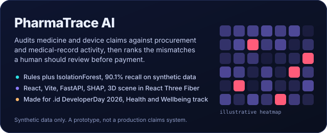
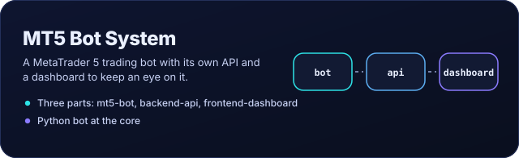
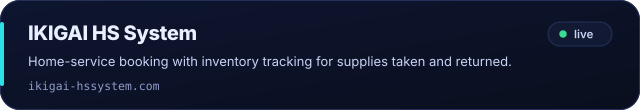
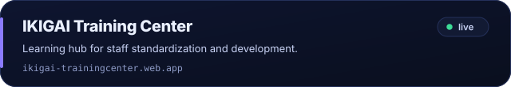

  

  
  
  
  

### About

I started in lab equipment support, moved into inventory and stock control, and ended up where data meets software. Today I analyse sales and stock for a multi-outlet service business, build the internal systems it runs on, and take client projects through Vickypedia ID.

I'm also studying Statistics at Universitas Terbuka, and I once founded my university's official Esports club.

### Career

  

At Reliable I reconciled and analysed stock, sales and purchase data across 24 branches for director-level reporting. At IKIGAI I report on 10 KPIs every week, month and year, and I build the platforms below.

### Stack

<table>
  <tr>
    <td><b>Build</b></td>
    <td>
      <picture>
        <source media="(prefers-color-scheme: light)" srcset="https://skillicons.dev/icons?i=ts,js,react,vite,tailwind,nodejs,express,fastapi,prisma,threejs&theme=light">
        
      </picture>
    </td>
  </tr>
  <tr>
    <td><b>Data and AI</b></td>
    <td>
      <picture>
        <source media="(prefers-color-scheme: light)" srcset="https://skillicons.dev/icons?i=py,pandas,numpy,sklearn,powerbi&theme=light">
        
      </picture>
    </td>
  </tr>
  <tr>
    <td><b>Ship</b></td>
    <td>
      <picture>
        <source media="(prefers-color-scheme: light)" srcset="https://skillicons.dev/icons?i=docker,postgres,mysql,sqlite,firebase,netlify,git,githubactions&theme=light">
        
      </picture>
    </td>
  </tr>
</table>

Also: SQL, VBA, SHAP, Matplotlib.

### Selected work

  

  

  

Built for IKIGAI Hotstone Massage & Reflexology:

  

  

More in [repositories](https://github.com/vickynfrdnto?tab=repositories).

### Recognition

| When | Result | Competition | Project |
| :-- | :-- | :-- | :-- |
| Nov 2025 | **Top 30** | Amartha x GDG (Google Developer Group) Jakarta Hackathon | *Arisan Pintar*, a digital finance product that empowers women |
| Nov 2024 | **Top 9 finalist** | Turnamen Sains Data Nasional | *Medysinc*, stock monitoring and prediction for health facilities with generative AI and disease trend forecasting |

  

  
  
  
  

